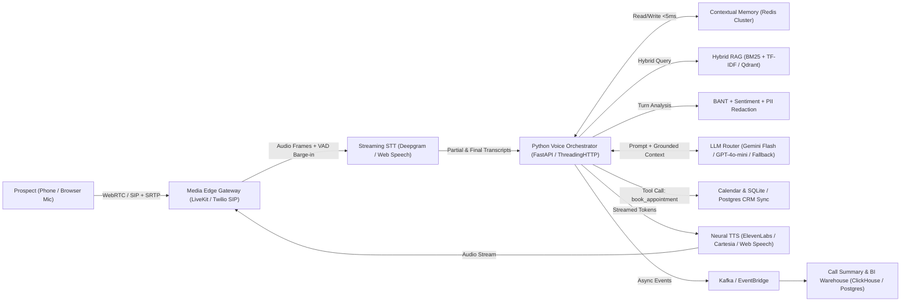

# System Architecture, Commercial Feasibility & 100k-User Scalability Strategy (Python Edition)

## 1. Business Problem & Value Proposition

B2B sales teams lose **35–50% of inbound pipeline** due to slow lead response times ("speed-to-lead" averages 4+ hours), manual CRM logging (~14 hours/rep/week), and lack of 24/7 multilingual coverage. Traditional rule-based IVRs and text chatbots frustrate buyers and fail to qualify complex deals or handle pricing/security objections.

**NexaCloud AI's Autonomous Sales Voice Agent** answers inbound leads or dials outbound prospects in **under 30 seconds**, conducts natural sub-500ms multilingual voice conversations grounded in verified company knowledge (RAG), qualifies leads on **BANT** (Budget, Authority, Need, Timeline), books demos directly onto AE calendars, and syncs structured summaries into the CRM.

---

## 2. System Architecture Diagram

### End-to-End Business Workflow (Implemented in Python MVP)
1. **Call Initiation (`POST /api/calls/start`)**: Creates an isolated session with contextual memory and greets the prospect in their preferred language (`en`, `hi`, `es`, `fr`, `de`).
2. **Real-Time Turn Processing (`POST /api/calls/:id/turn`)**:
   - Detects language changes mid-call (e.g., English → Hindi).
   - Extracts entities (`name`, `company`, `role`, `teamSize`, `budget`, `timeline`, `painPoints`) and computes BANT score (`0–100`) + Sentiment (`Positive` / `Neutral` / `Skeptical` / `Frustrated`).
   - Retrieves top-3 grounded knowledge chunks via Hybrid BM25 + `scikit-learn` TF-IDF cosine similarity.
   - Detects booking intent/confirmation and atomically inserts an appointment row into **SQLite (`data/crm.db`)** with `UNIQUE(date, time, status)` double-booking protection.
   - Generates a concise spoken response (via Gemini/OpenAI if configured, or built-in deterministic RAG engine) and pushes an SSE update to the CRM dashboard.
3. **Call Completion (`POST /api/calls/:id/end`)**: Produces an executive summary, next best action, follow-up email draft, and updates aggregate Business Insights KPIs.

---

## 3. Commercial Feasibility & Unit Economics

- **Starter**: \$299/month (up to 10 seats, 5,000 workflow runs)
- **Growth**: \$899/month (up to 50 seats, 50,000 runs, CRM + SSO)
- **Enterprise**: \$2,400+/month (dedicated VPC, 99.99% SLA)

| Component | Provider Example | Cost / Minute |
|---|---|---|
| Streaming STT | Deepgram Nova-2 | \$0.0043 |
| LLM Reasoning | Gemini 2.5 Flash (~1.5k tok/min) | \$0.0020 |
| Neural TTS | Cartesia Sonic / ElevenLabs Turbo | \$0.0150 |
| Telephony / WebRTC | Twilio SIP / LiveKit Cloud | \$0.0085 |
| Vector RAG + Redis + Observability | Amortized infra | \$0.0022 |
| **Total Variable COGS** | | **~\$0.032 / min** |

At **150 voice minutes/seat/month** (\$4.80 COGS/seat) on a **\$30–\$50/seat** SaaS price, gross margin is **~84–90%**.

---

## 4. Scalability Strategy (Supporting up to 100,000 Users)

- **100,000 registered sales users** → **2,000–3,000 peak concurrent calls** (~375 turn QPS).
- **Media Plane Isolation**: LiveKit / SIP edge nodes across 3 regions (`us-east`, `eu-west`, `ap-south`) keep RTP jitter <30ms.
- **Stateless Python Orchestrators**: FastAPI/Uvicorn worker pods run in **Kubernetes (EKS/GKE)** with HPA scaling on WebSocket count and CPU (<60%).
- **Sub-5ms Session State**: Redis Cluster stores active conversation state with 24-hour TTL.
- **Sharded Hybrid RAG**: Tenant-partitioned Qdrant / pgvector + BM25 keeps P95 retrieval under **25ms**.
- **Async CRM Pipeline**: Kafka decouples HubSpot/Salesforce API rate limits from the real-time voice path.

---

## 5. Data Security, Infrastructure & Operational Costs

- **Security**: TLS 1.3 + SRTP media encryption, AES-256 KMS at rest, `redact_pii()` masking before telemetry storage, RBAC tenant isolation, SOC 2 Type II / GDPR / DPDP / TCPA compliance.
- **Monthly Cost Breakdown**:

| Scale Tier | Active Users | Peak Concurrent Calls | Monthly Voice Mins | Cloud Infra | Voice/AI Variable COGS | Total Monthly Ops Cost |
|---|---|---|---|---|---|---|
| **MVP / Pilot** | 1,000 | 30 | 150,000 | \$450 | \$4,800 | **\$5,250** |
| **Growth** | 10,000 | 300 | 1,500,000 | \$2,400 | \$42,000 | **\$44,400** |
| **Enterprise Scale** | **100,000** | **3,000** | **15,000,000** | **\$14,500** | **\$345,000** | **~\$359,500** (\$3.60/user/mo) |
